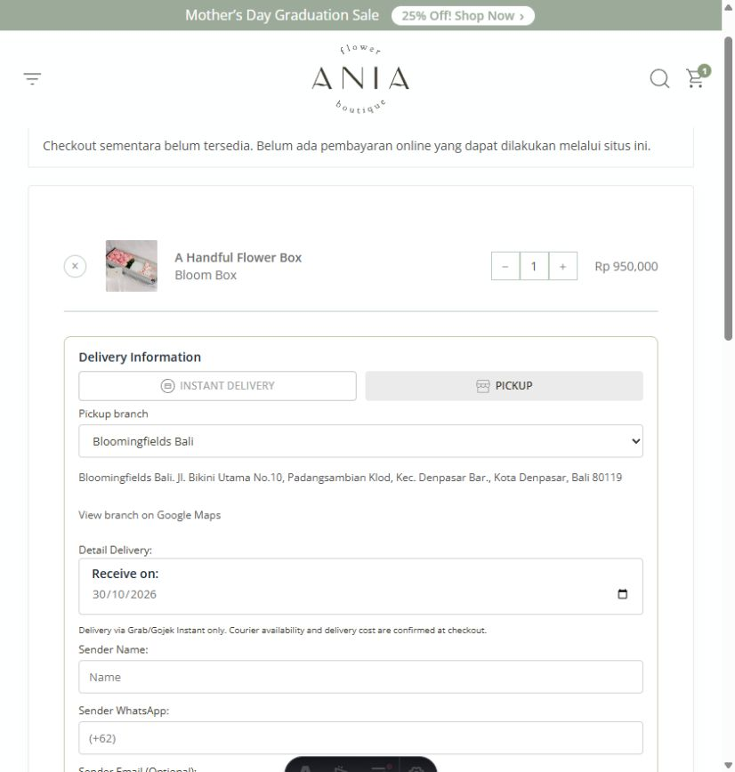

# Pickup branches and Instant origin selection

Implemented 30 October 2026, using the pickup links supplied by ANIA.

- Jakarta: Bloomingfields, Kebon Jeruk. Pin -6.1984118, 106.7677326.
- Bali: Bloomingfields Bali, Jl. Bikini Utama No.10, Denpasar. Pin -8.6754898, 115.1862615.
- Tangerang: The HOOD CR6, coming soon; disabled in UI and rejected by server.
- Pickup selects an active branch with zero delivery charge. The server supplies its address.
- Instant defaults to the nearest active branch by straight-line distance from the confirmed recipient pin. Manual override is available. This does not guarantee stock, cheapest price, or courier availability.
- No Biteship request on branch selection or pin changes. Only the explicit cart delivery check queries one selected origin; successful quotes cache for 90 seconds by origin/destination/items. Checkout revalidates the quote.
- Orders preserve their selected origin for admin booking. Legacy orders without an origin and changed/inactive origins require manual review. Existing tracking remains available.
- Checkout stays OFF. No real invoice, payment, or courier booking was created during these checks.
- Admin settings explanation and Instant/booking SOP updated.

Validation: production build succeeds; Astro check 0 errors/0 warnings (10 pre-existing hints). 23 branch/payment/shipping/cart tests, 10 isolated-local-DB booking tests, and 4 admin-guide tests pass. Provider calls are mocked in automated tests.

Browser checks: Pickup Bali persists from product to cart with Rp0 delivery; automatic Bali suggestion follows a Bali pin; manual override to Jakarta updates the origin; Tangerang is disabled; checkout and rate buttons remain disabled while OFF.

Local screenshots demonstrate UI behavior, not live courier availability or a real transaction.
